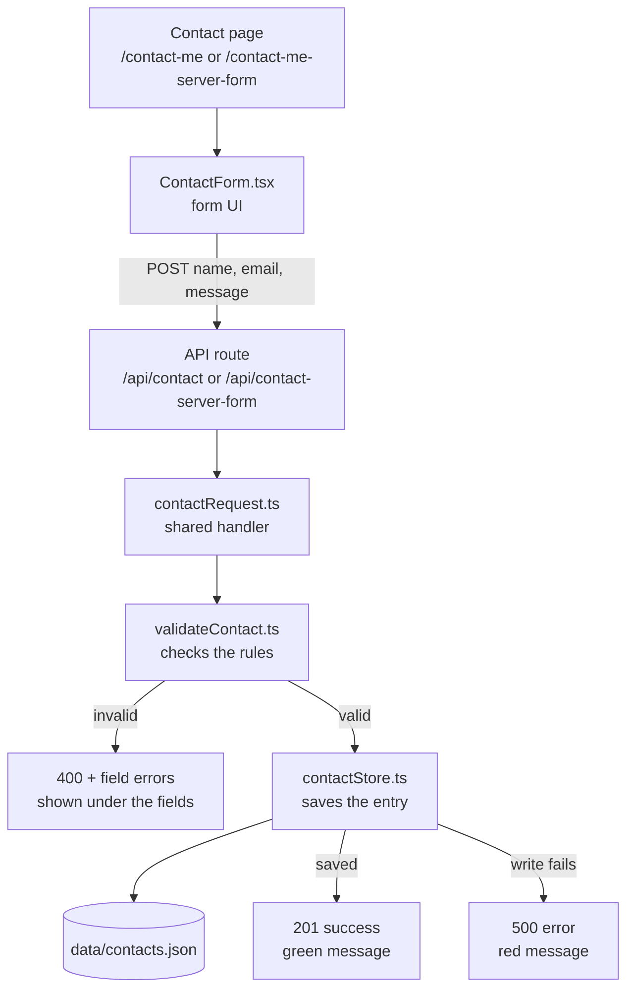
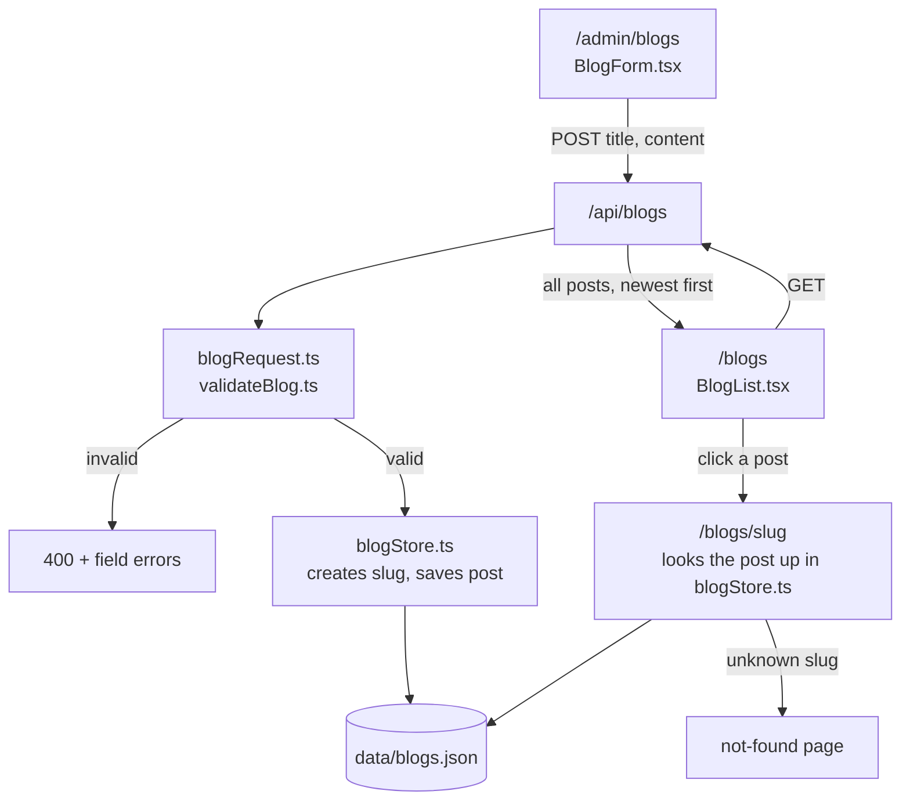

# Portfolio — ISBA2438

A personal portfolio built with Next.js (App Router), TypeScript, and Tailwind CSS.

## Getting started

```bash
npm install
npm run dev
```

Open http://localhost:3000 in your browser.

## Scripts

| Command           | What it does                                  |
| ----------------- | --------------------------------------------- |
| `npm run dev`     | Dev server at http://localhost:3000           |
| `npm run build`   | Production build (also runs TypeScript check) |
| `npm run start`   | Serve the production build                    |
| `npm run lint`    | ESLint                                        |
| `npm test`        | Unit tests (Vitest)                           |

## Pages

| Route                          | What it shows                          |
| ------------------------------ | -------------------------------------- |
| `/`                            | Landing page                           |
| `/about-me`                    | Bio, skills, education                 |
| `/projects`                    | Project cards, linked from `src/data/projects.ts` |
| `/projects/[slug]`             | Project detail (unknown slugs get a friendly `not-found.tsx`) |
| `/blogs`                       | Blog list, fetched client-side from `/api/blogs` |
| `/blogs/[slug]`                | Blog post detail, read at request time (unknown slugs get a friendly `not-found.tsx`) |
| `/admin/blogs`                 | Form to publish a post via `/api/blogs` |
| `/contact-me`                  | Contact form posting to `/api/contact` |
| `/contact-me-server-form`      | Contact form posting to the API below  |

## Architecture

### Contact form flow

What happens when someone submits either contact page:



| Step | File | What it does |
| ---- | ---- | ------------ |
| Pages | `src/app/contact-me/page.tsx`, `src/app/contact-me-server-form/page.tsx` | Render the form. Each passes its own endpoint to the form. |
| Form | `src/components/ContactForm.tsx` | Holds the field values, sends the POST, shows success, field errors or a failure message. It has no validation rules of its own. |
| API routes | `src/app/api/contact/route.ts`, `src/app/api/contact-server-form/route.ts` | Thin wrappers that call the shared handler. |
| Handler | `src/lib/contactRequest.ts` | Parses the request, validates, saves, and returns 400, 201 or 500. |
| Validation | `src/lib/validateContact.ts` | Trims the values and applies the name, message and email rules. |
| Storage | `src/lib/contactStore.ts` | Appends `{ id, name, email, message, submittedAt }` to `data/contacts.json`. |

### Blog flow



Notes:

- Pages live in `src/app` and use file-system routing; the shared `Navbar`
  (`src/components/Navbar.tsx`) is rendered by the root layout
  `src/app/layout.tsx`.
- Project content is data-driven from `src/data/projects.ts`;
  `/projects/[slug]` uses `generateStaticParams` for the known slugs and
  `notFound()` for anything else.
- Validation rules live only in `src/lib/validateContact.ts` (the server is
  the source of truth); `ContactForm` renders whatever errors the API returns
  and performs no client-side validation.
- `data/contacts.json` is runtime data (committed as an empty `[]`; the app
  appends submissions to it).
- Blog posts live in `data/blogs.json` and are served by `/api/blogs`
  (`GET` returns posts newest-first and is never cached; `POST` creates one),
  handled by `src/lib/blogRequest.ts`. Both stores share the JSON file
  helpers in `src/lib/jsonFileStore.ts`.
- `/admin/blogs` has no authentication (not required by the assignment), so
  anyone who knows the URL can publish a post.

## Part 2: Critique of the generated code

Three examples of reviewing what the Viber agent produced.

### 1. One shared handler for both contact endpoints

- **Files / commit:** `src/lib/contactRequest.ts`,
  `src/app/api/contact/route.ts`, `src/app/api/contact-server-form/route.ts`
  (commit `8543f68`)
- **What the agent proposed:** my prompt asked for a new `/api/contact`
  endpoint without copying logic. The agent moved the existing route's body
  into `handleContactPost` in `contactRequest.ts` and made both route files
  thin wrappers around it.
- **What I decided and why:** I accepted it. Validation and saving now live in
  one place, so both contact pages behave the same and write to the same
  `data/contacts.json`.
- **How I checked it:** I sent POST requests with `curl` to both endpoints.
  A valid body returned 201 on both, a blank name with the email `a@b`
  returned 400 with field errors, and malformed JSON returned 400. Both valid
  submissions appeared in the same `data/contacts.json`.

### 2. Blog pages that show new posts without a rebuild

- **Files / commit:** `src/app/blogs/[slug]/page.tsx`,
  `src/components/BlogList.tsx` (commit `85328de`)
- **What the agent proposed:** `next.config.ts` enables `cacheComponents`,
  where `export const dynamic = "force-dynamic"` is not allowed. The agent
  instead awaited `connection()` inside a `<Suspense>` boundary on the post
  page, avoided `generateStaticParams` for blog slugs, and had `/blogs` fetch
  `GET /api/blogs` in the browser.
- **What I decided and why:** I accepted it. Posts are created at runtime, so
  a statically generated page would not show a new post until a rebuild.
- **How I checked it:** I published a post at `/admin/blogs`, then opened
  `/blogs` and the new post's `/blogs/<slug>` page, first in dev and then
  after `npm run build` and `npm run start`. The post saved and appeared
  immediately in both, and an unknown slug showed the "not found" page.

### 3. Form inputs disappeared after the restyle

- **Files / commit:** `src/app/globals.css`, `src/components/ContactForm.tsx`
  (commit `85328de`)
- **What the agent proposed:** in the UI polish it moved the input, label and
  banner styles into shared classes (`.field-input`, `.field-label`,
  `.banner-success`) in `globals.css`.
- **What I decided and why:** I kept that design, because it removes repeated
  long class lists. But on my running dev server the form fields were
  invisible: the classes were on the elements, but the served stylesheet did
  not contain them.
- **How I checked it:** the production build's CSS did contain the classes,
  so the code was correct and the dev server was serving stale CSS. I stopped
  the dev server, deleted `.next`, and restarted it. After that the Name,
  Email and Message boxes rendered correctly.
