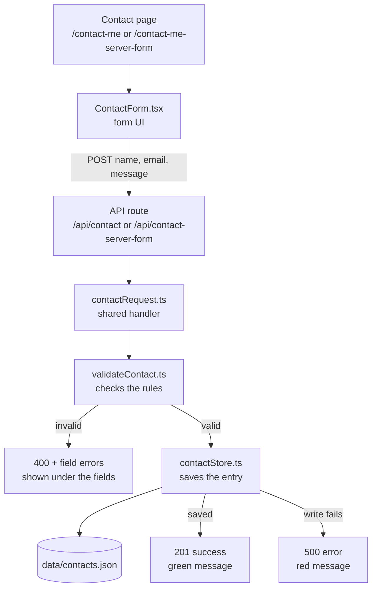
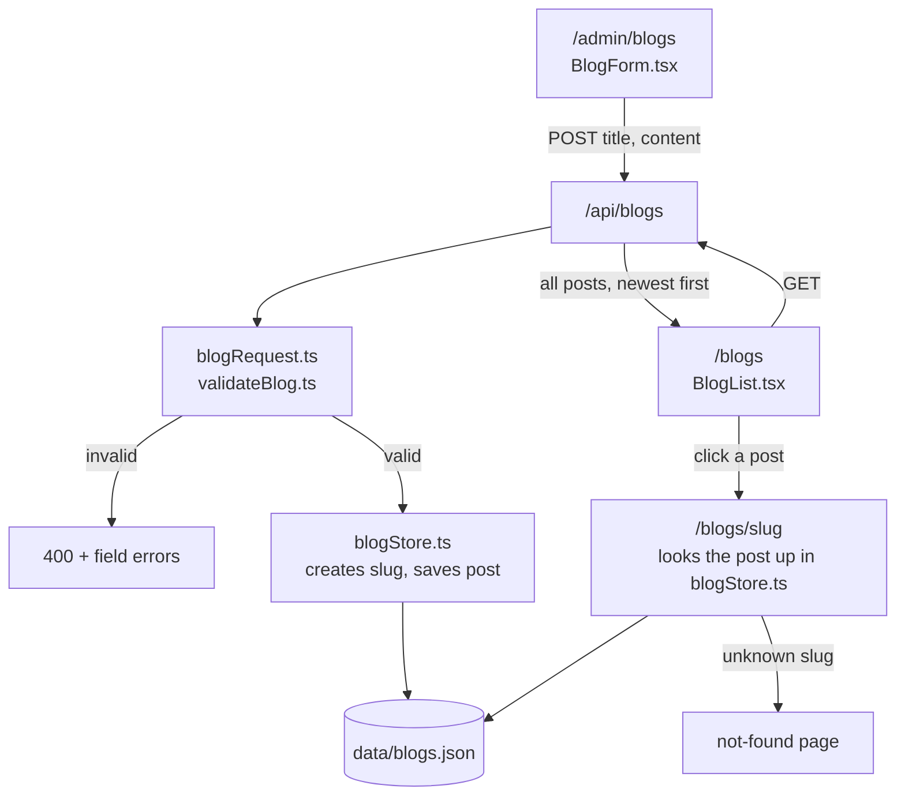
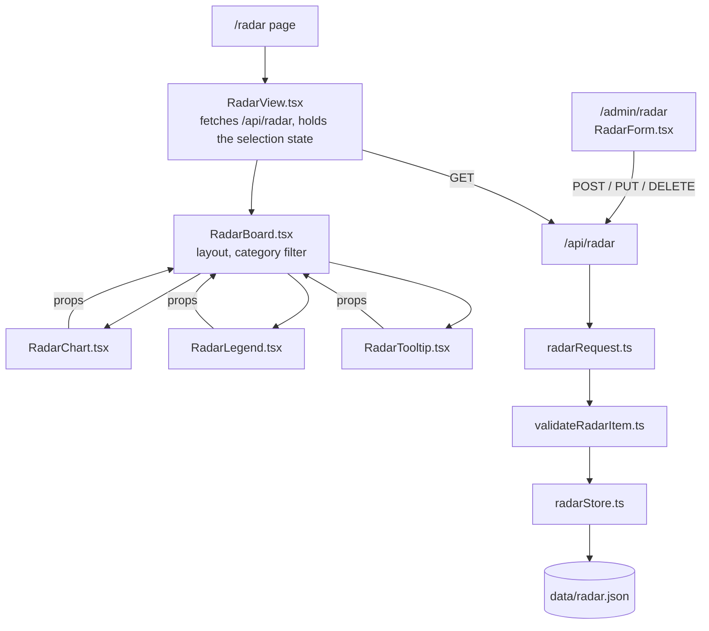
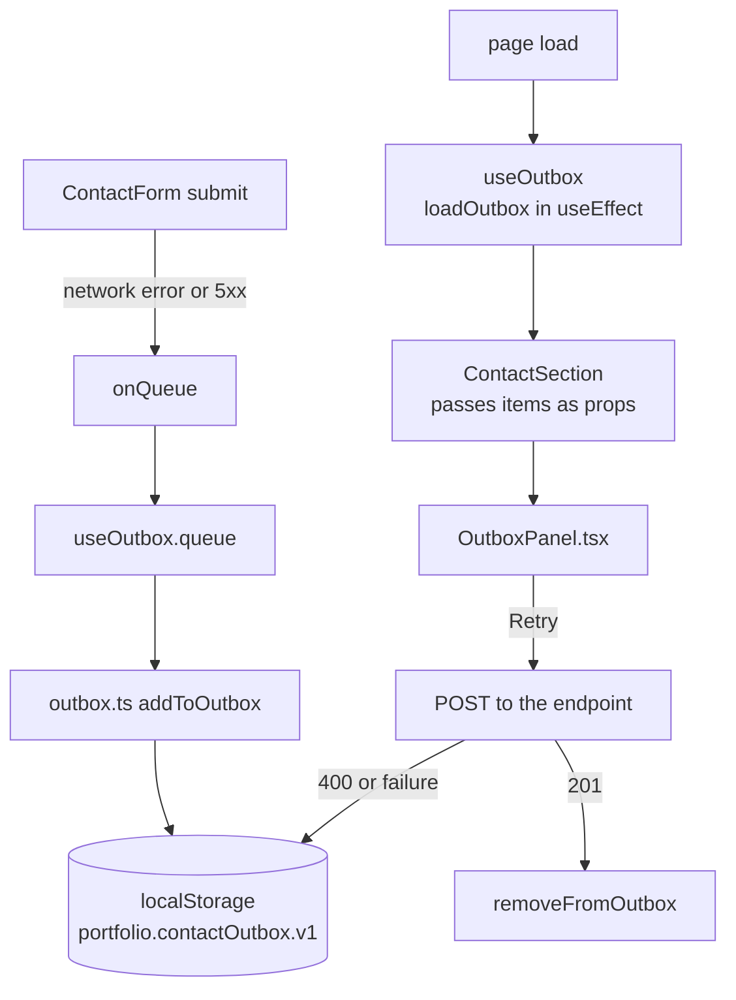

# Portfolio — ISBA2438

A personal portfolio built with Next.js (App Router), TypeScript, and Tailwind CSS.

## Getting started

```bash
npm install
npm run dev
```

Open http://localhost:3000 in your browser.

## Scripts

| Command           | What it does                                  |
| ----------------- | --------------------------------------------- |
| `npm run dev`     | Dev server at http://localhost:3000           |
| `npm run build`   | Production build (also runs TypeScript check) |
| `npm run start`   | Serve the production build                    |
| `npm run lint`    | ESLint                                        |
| `npm test`        | Unit tests (Vitest)                           |

## Pages

| Route                          | What it shows                          |
| ------------------------------ | -------------------------------------- |
| `/`                            | Landing page                           |
| `/about-me`                    | Bio, skills, education                 |
| `/projects`                    | Project cards, served from `data/projects.json` through `src/lib/projectStore.ts` |
| `/projects/[slug]`             | Project detail (unknown slugs get a friendly `not-found.tsx`) |
| `/blogs`                       | Blog list, fetched client-side from `/api/blogs` |
| `/blogs/[slug]`                | Blog post detail, read at request time (unknown slugs get a friendly `not-found.tsx`) |
| `/radar`                       | Interactive Tech Radar: chart, ring guide, category filter, All items list |
| `/admin`                       | Admin hub linking to the four admin pages |
| `/admin/blogs`                 | Publish, edit and delete posts via `/api/blogs` |
| `/admin/projects`              | Publish, edit and delete projects via `/api/projects` |
| `/admin/contacts`              | Read, update and delete submissions via `/api/contact` |
| `/admin/radar`                 | Publish, edit and delete radar items via `/api/radar` |
| `/contact-me`                  | Contact form posting to `/api/contact` |
| `/contact-me-server-form`      | Contact form posting to the API below  |

## API

All endpoints are JSON in and JSON out. Every handler logs `METHOD path status`
(for example `POST /api/blogs 201`) to the server console.

| Endpoint                  | Methods        | Status codes |
| ------------------------- | -------------- | ------------ |
| `/api/contact`            | `GET`, `POST`  | `200`, `201`, `400`, `500` |
| `/api/contact-server-form`| `POST`         | `201`, `400`, `500` |
| `/api/blogs`              | `GET`, `POST`  | `200`, `201`, `400`, `500` |
| `/api/projects`           | `GET`, `POST`  | `200`, `201`, `400`, `500` |
| `/api/radar`              | `GET`, `POST`  | `200`, `201`, `400`, `500` |
| `/api/contact/[id]`       | `GET`, `PUT`, `DELETE` | `200`, `400`, `404`, `500` |
| `/api/blogs/[id]`         | `GET`, `PUT`, `DELETE` | `200`, `400`, `404`, `500` |
| `/api/projects/[id]`      | `GET`, `PUT`, `DELETE` | `200`, `400`, `404`, `500` |
| `/api/radar/[id]`         | `GET`, `PUT`, `DELETE` | `200`, `400`, `404`, `500` |

`400` means invalid JSON or failed validation (the body contains `{ error, errors }` with field errors), `404` an unknown id (`{ error: "… not found." }`), and `500` a storage failure. `GET` responses are never cached.

## Architecture

### Contact form flow

What happens when someone submits either contact page:



| Step | File | What it does |
| ---- | ---- | ------------ |
| Pages | `src/app/contact-me/page.tsx`, `src/app/contact-me-server-form/page.tsx` | Render the form. Each passes its own endpoint to the form. |
| Form | `src/components/ContactForm.tsx` | Holds the field values, sends the POST, shows success, field errors or a failure message. It has no validation rules of its own. |
| API routes | `src/app/api/contact/route.ts`, `src/app/api/contact-server-form/route.ts` | Thin wrappers that call the shared handler. |
| Handler | `src/lib/contactRequest.ts` | Parses the request, validates, saves, and returns 400, 201 or 500. |
| Validation | `src/lib/validateContact.ts` | Trims the values and applies the name, message and email rules. |
| Storage | `src/lib/contactStore.ts` | Appends `{ id, name, email, message, submittedAt }` to `data/contacts.json`. |

### Blog flow



Notes:

- Pages live in `src/app` and use file-system routing; the shared `Navbar`
  (`src/components/Navbar.tsx`) is rendered by the root layout
  `src/app/layout.tsx`.
- Project content is served from `data/projects.json` through
  `src/lib/projectStore.ts` and the `/api/projects` endpoints; the projects
  pages read it at request time (`connection()` + `<Suspense>`), so new
  projects appear without a rebuild.
- Validation rules live only in `src/lib/validateContact.ts` (the server is
  the source of truth); `ContactForm` renders whatever errors the API returns
  and performs no client-side validation.
- Blog posts live in `data/blogs.json` and are served by `/api/blogs`
  (`GET` returns posts newest-first and is never cached; `POST` creates one),
  handled by `src/lib/blogRequest.ts`. Both stores share the JSON file
  helpers in `src/lib/jsonFileStore.ts`.
- The `/admin/*` pages have no authentication (not required by the
  assignment), so anyone who knows the URL can edit the content.
- `data/contacts.json`, `data/blogs.json`, `data/projects.json` and
  `data/radar.json` are runtime data (committed as empty `[]` or seeded
  content; the app appends to and edits them at runtime).

### Tech Radar (custom backend feature)

The Tech Radar is an interactive chart of tools and skills, fully backed by
the custom API.



- `radarLayout.ts` is a pure function that places every item on the 800×800
  chart (rings, quadrants, numbering, collision-free spacing).
- `categoryStyles.ts` is the single source of truth for the four category
  colors used by the chart, legend, filter and tooltip.

### LocalStorage contact outbox

If the contact form cannot reach the server, the message is queued in the
browser and can be retried later.



- Data handling: on load, an empty or missing key, corrupt JSON, JSON that is
  not an array, and wrong-shape entries are dropped and counted; the panel
  tells the user how many saved messages were removed.
- `400` responses (validation errors) are never queued — they are shown as
  field errors; only network errors and 5xx responses are queued.
- Limits of LocalStorage: it is per browser and per device (a message queued
  in Chrome on one laptop will not appear in Safari or on a phone), it stores
  plain text, it holds about 5 MB per origin, and the user (or a private
  window) can clear it at any time.

## Components

| Component | Props | What it does |
| --------- | ----- | ------------ |
| `ProjectCard.tsx` | `project: Project` | One project card: link, title, summary, tech pills. |
| `BlogCard.tsx` | `post: BlogPost` | One blog card: link, title, formatted date, excerpt. |
| `RadarBoard.tsx` | `items, selectedId, onSelect, hoveredId, onHover, selectedCategory, onSelectCategory` | Lays out the radar page: ring guide, chart, filter, All items list. |
| `RadarChart.tsx` | `items, selectedId, onSelect, hoveredId, onHover, selectedCategory` | The SVG radar: rings, quadrants, dots, sweep, tooltips. |
| `RadarLegend.tsx` | `items, selectedId, onSelect, hoveredId, onHover, selectedCategory` | The four ring columns of All items. |
| `RadarTooltip.tsx` | `item, x, y` | The info card shown for the active radar item. |
| `ContactSection.tsx` | `endpoint: string` | Wires `ContactForm` and `OutboxPanel` to one `useOutbox`. |
| `OutboxPanel.tsx` | `items, discarded, ready, onRetry, onDiscard, onRetryAll` | Lists unsent messages with Retry / Discard actions. |
| `ContactForm.tsx` | `endpoint?: string`, `onQueue?: (fields) => void` | The contact form; queues the message on network errors or 5xx. |

## Part 2: Critique of the generated code

Three examples of reviewing what the Viber agent produced.

### 1. One shared handler for both contact endpoints

- **Files / commit:** `src/lib/contactRequest.ts`,
  `src/app/api/contact/route.ts`, `src/app/api/contact-server-form/route.ts`
  (commit `8543f68`)
- **What the agent proposed:** my prompt asked for a new `/api/contact`
  endpoint without copying logic. The agent moved the existing route's body
  into `handleContactPost` in `contactRequest.ts` and made both route files
  thin wrappers around it.
- **What I decided and why:** I accepted it. Validation and saving now live in
  one place, so both contact pages behave the same and write to the same
  `data/contacts.json`.
- **How I checked it:** I sent POST requests with `curl` to both endpoints.
  A valid body returned 201 on both, a blank name with the email `a@b`
  returned 400 with field errors, and malformed JSON returned 400. Both valid
  submissions appeared in the same `data/contacts.json`.

### 2. Blog pages that show new posts without a rebuild

- **Files / commit:** `src/app/blogs/[slug]/page.tsx`,
  `src/components/BlogList.tsx` (commit `85328de`)
- **What the agent proposed:** `next.config.ts` enables `cacheComponents`,
  where `export const dynamic = "force-dynamic"` is not allowed. The agent
  instead awaited `connection()` inside a `<Suspense>` boundary on the post
  page, avoided `generateStaticParams` for blog slugs, and had `/blogs` fetch
  `GET /api/blogs` in the browser.
- **What I decided and why:** I accepted it. Posts are created at runtime, so
  a statically generated page would not show a new post until a rebuild.
- **How I checked it:** I published a post at `/admin/blogs`, then opened
  `/blogs` and the new post's `/blogs/<slug>` page, first in dev and then
  after `npm run build` and `npm run start`. The post saved and appeared
  immediately in both, and an unknown slug showed the "not found" page.

### 3. Form inputs disappeared after the restyle

- **Files / commit:** `src/app/globals.css`, `src/components/ContactForm.tsx`
  (commit `85328de`)
- **What the agent proposed:** in the UI polish it moved the input, label and
  banner styles into shared classes (`.field-input`, `.field-label`,
  `.banner-success`) in `globals.css`.
- **What I decided and why:** I kept that design, because it removes repeated
  long class lists. But on my running dev server the form fields were
  invisible: the classes were on the elements, but the served stylesheet did
  not contain them.
- **How I checked it:** the production build's CSS did contain the classes,
  so the code was correct and the dev server was serving stale CSS. I stopped
  the dev server, deleted `.next`, and restarted it. After that the Name,
  Email and Message boxes rendered correctly.
